# Amiral Battı

1600–1800 yelken çağında geçen, retro piksel (arcade) görünümlü amiral battı. Expo (React Native +
Web): aynı kod tarayıcıda ve iOS/Android'de çalışır. Ekranlar yatayda 1920×1080, dikeyde (telefon)
720×1280 tasarım tuvalinde çizilir ve pencereye oranla ölçeklenir; her ekranın mobil yerleşimi var.

Diller: Türkçe, İngilizce, Almanca, Fransızca, İspanyolca, Arapça (sağdan sola). Temalar: gece
(tasarım) ve gündüz (güneşli). İkisi de ayarlar (⚙) penceresinden değişir ve cihazda saklanır.

Ses: menüde ve oyunda ayrı müzik, top/isabet/ıska/batış ve arayüz efektleri; seviyeleri ayarlardan.
Hepsi telifsiz (CC0); kaynaklar `assets/sounds/CREDITS.md`.

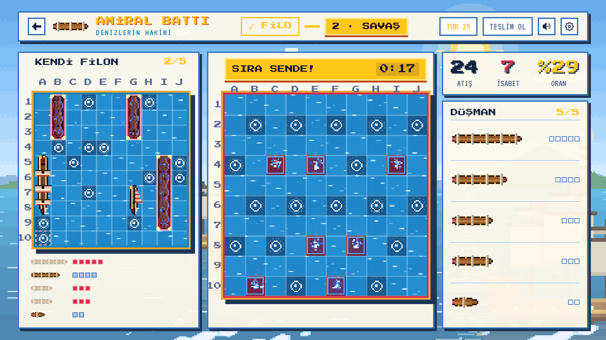

## Ekran görüntüleri

| Kapak                                            | Giriş                                           |
| ------------------------------------------------ | ----------------------------------------------- |
| 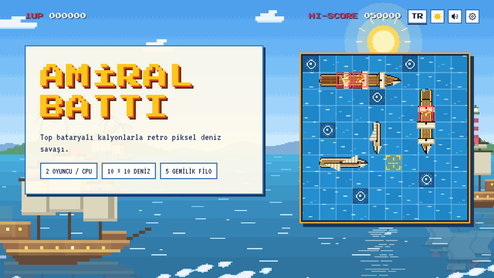             | 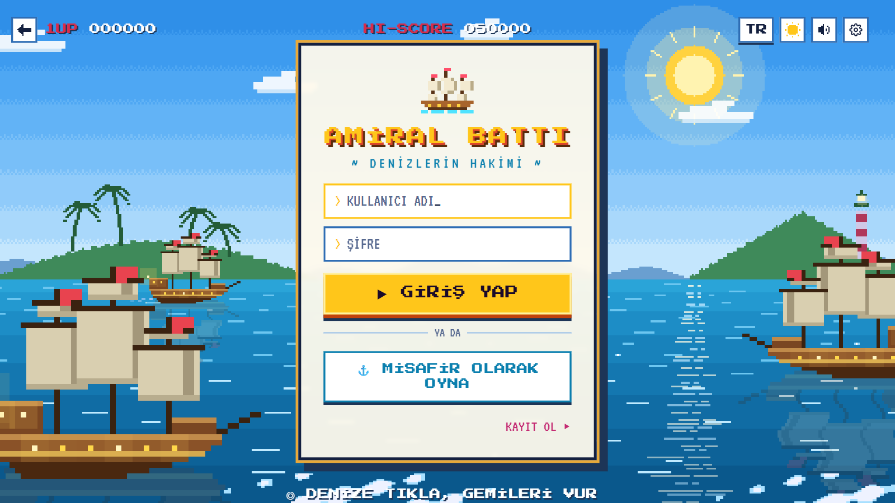            |
| **Mod menüsü**                                   | **Mod menüsü (gece)**                           |
| 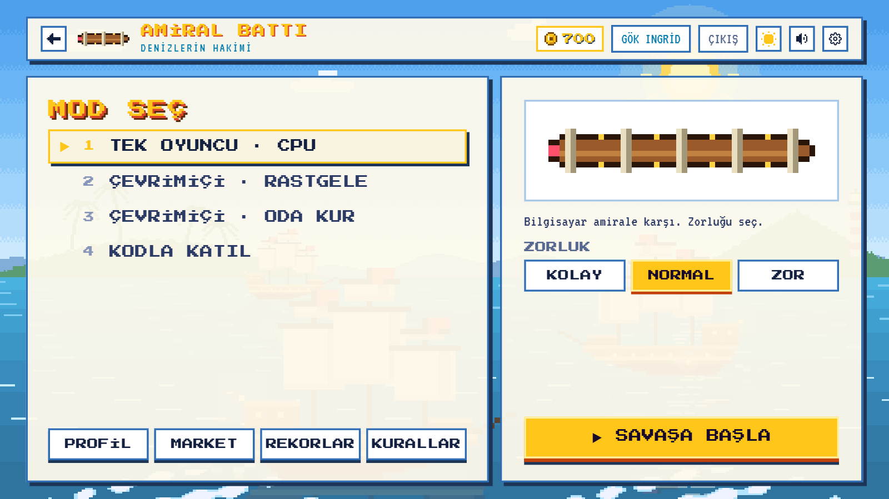               | 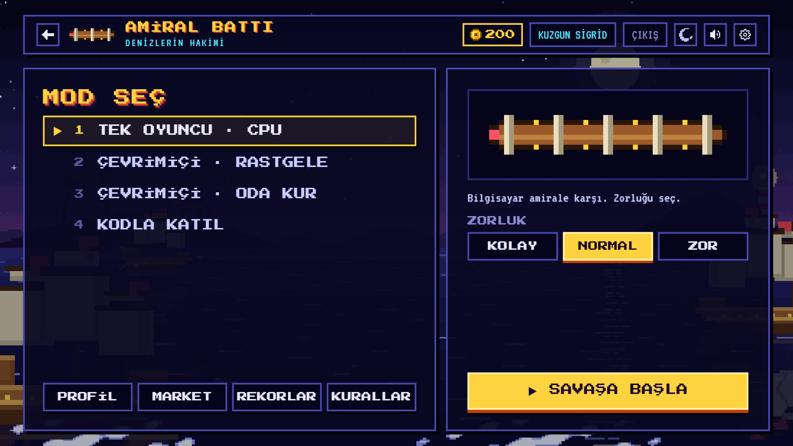    |
| **Filo yerleştirme**                             | **Savaş (gece)**                                |
| 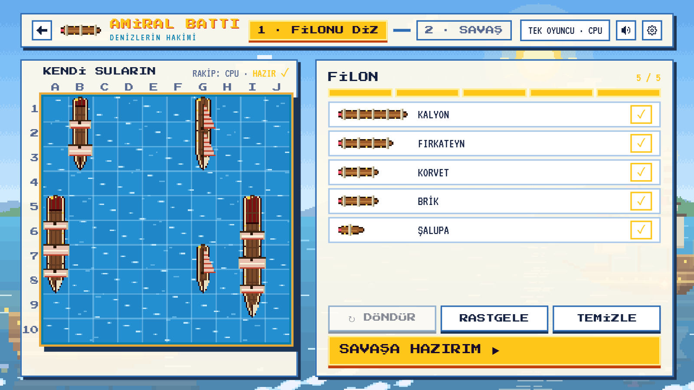 | 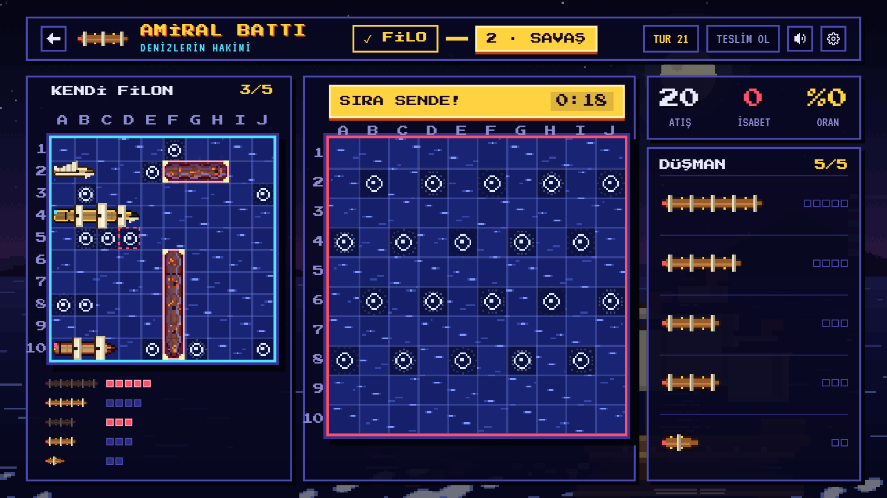  |
| **Market: gemi boyaları**                        | **Market: alevler**                             |
| 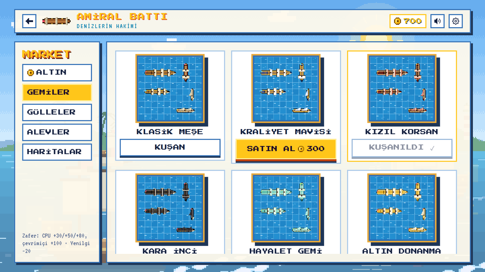           | 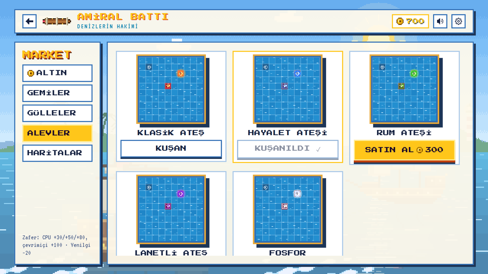 |
| **Oyun sonu**                                    | **Oda**                                         |
| 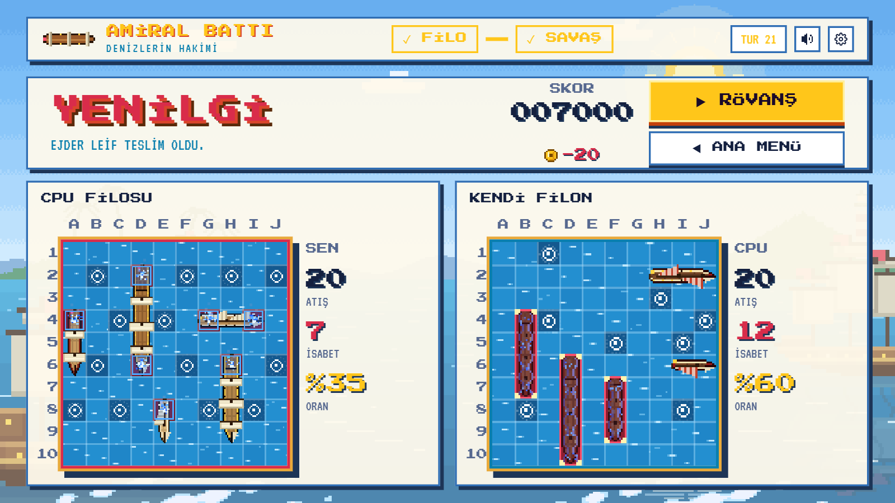     | 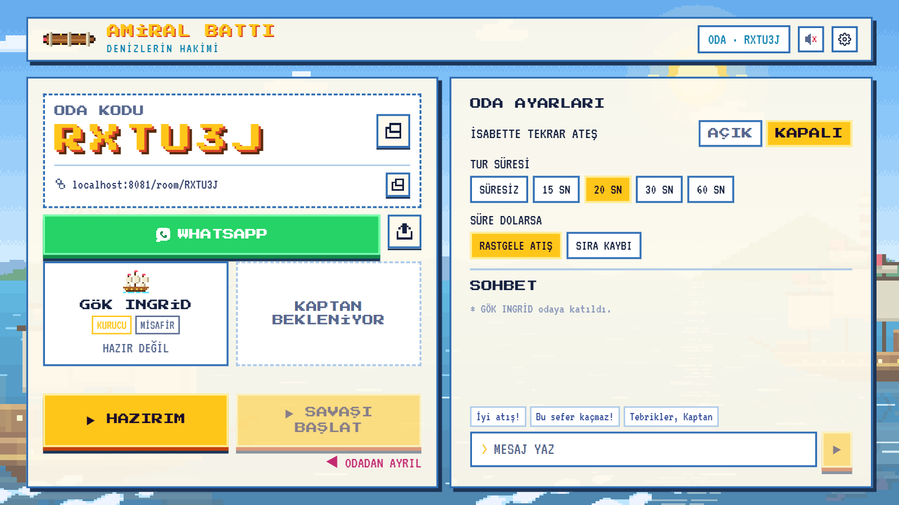                |

Telefon (dikey):

<p>
  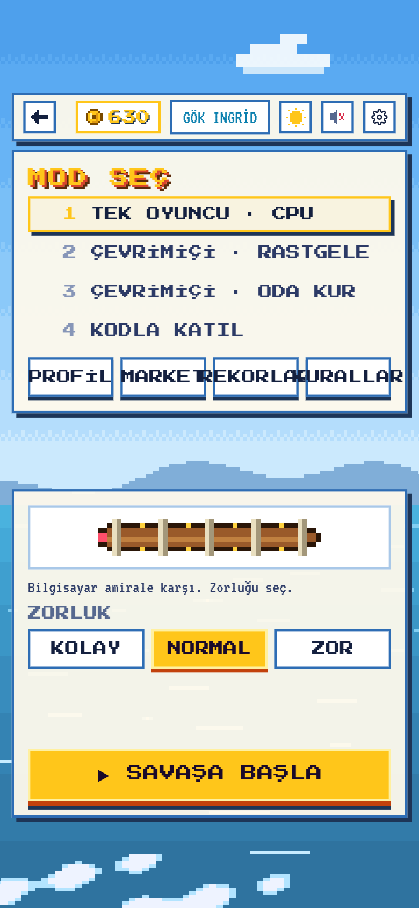
  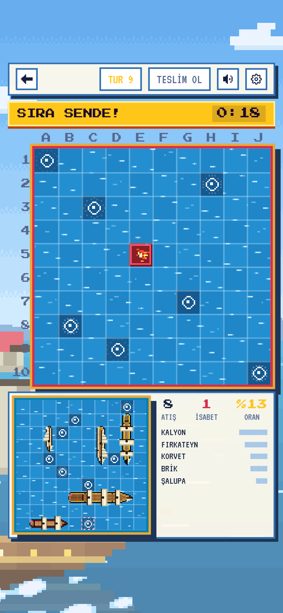
</p>

## Çalıştırma

```bash
npm install
npx expo start --web     # tarayıcı
npx expo start           # telefonda Expo Go ile QR kodu okut
```

| Komut                   | Ne yapar                                |
| ----------------------- | --------------------------------------- |
| `npm test`              | Birim testleri (Vitest)                 |
| `npm run test:coverage` | Oyun motoru kapsam raporu (eşik %90)    |
| `npm run typecheck`     | TypeScript (strict)                     |
| `npm run lint`          | ESLint (React Compiler kuralları dahil) |
| `npm run format`        | Prettier                                |

Akış: Kapak (`/`) → Giriş (`/login`) → Mod menüsü (`/lobby`) → Filo yerleştirme → Savaş → Oyun sonu.
Her ekranda geri düğmesi var; girişli oyuncu kapaktan doğrudan menüye geçer.
Diğer ekranlar: kaptan kartı ve misafiri hesaba dönüştürme (`/profile`), rekor tablosu (`/scores`),
kurallar (`/how-to`), market (`/shop`), oda (`/room/KOD`), eşleşme (`/matchmaking`). Skorlar ve oyun geçmişi cihazda
saklanır (src/store/recordsStore.ts).

## Modlar

- **Bilgisayara karşı:** Kolay (rastgele), Normal (avla/hedefle), Zor (olasılık haritası).
- **Çevrimiçi (şimdilik sahte):** rastgele rakip, oda kur (6 haneli kod + link), kodla/linkle katıl,
  oda ve oyun içi sohbet. Oda kodu ve linki tek dokunuşla kopyalanır, WhatsApp'ta paylaşılır.
  Karşı tarafı bir bot oynar; arayüz gerçek sunucuya hazır.

## Altın ve market

- Yeni kaptan 200 altınla başlar. Zafer: bilgisayara karşı +30 / +50 / +80 (kolay / normal / zor),
  çevrimiçi +100. Yenilgi: -20 (bakiye 0'ın altına inmez). Oda kurmak 50 altın.
- Market (`/shop`): altın paketleri ve kozmetikler. Gemi boyası, gülle, isabet alevi ve harita
  (deniz rengi, gece ve gündüz hali). Gemi boyası yalnız kendi filona, diğerleri iki tahtaya da uygulanır.
- Altın paketleri şimdilik **demo**: gerçek ödeme alınmaz. Kurallar ve ürünler
  `src/features/shop/catalog.ts`, kese `src/store/walletStore.ts` (cihazda saklanır).

## Mimari

```
src/game/        Saf TypeScript oyun motoru: kurallar, applyAction, getPlayerView, yapay zekâ.
                 React/Expo import'u yasak (ESLint). Sunucu aynı motoru çalıştıracak.
src/services/    Arayüzler + sahte (mock) uygulamalar. Gerçek sağlayıcılar takılınca değişen
                 tek yer src/services/index.ts.
  transport/     GameTransport arayüzü. GameHost: motor + tur saati + yapay zekâ + bağlantı kopması.
                 MockOnlineTransport: ağ gecikmeli sahte çevrimiçi.
  auth/ chat/ room/
src/features/    arcade/: piksel tema, tuval (Stage), canvas animasyonları (gece denizi, ızgara),
                 ekranlar. placement/ battle/: arayüzden bağımsız yerleştirme ve seyir defteri
                 mantığı. game/: oyun akışı (tek koltuk, aynı cihaz).
src/app/         expo-router ekranları; (app)/ grubu giriş ister.
src/ui/          Yazı tipi haritası (Press Start 2P, VT323).
src/i18n/        Tüm metinler: tr.json (kaynak) + en, de, fr, es, ar. Eksik çeviri derleme hatasıdır.
amiral-batti.html: referans tasarım ekranları.
```

Hile önleme: istemciye yalnızca `getPlayerView` gider; rakibin gemileri batana ya da oyun bitene
kadar görünümde yoktur. İstemci koltuk seçemez; taşıyıcı ekler.

## Sahte olanlar (gerçeğiyle değiştirilecek)

| Parça                | Şimdi                                        | Sonra                          |
| -------------------- | -------------------------------------------- | ------------------------------ |
| Kimlik               | `MockAuthService`, cihazda (AsyncStorage)    | Supabase/Firebase              |
| Oda, eşleşme, sohbet | Bellekte, karşı taraf bot                    | WebSocket / Colyseus sunucusu  |
| Çevrimiçi oyun       | `MockOnlineTransport` (yerel GameHost + bot) | Sunucuda GameHost              |
| Altın, market        | Cihazda kese, demo paketler                  | Sunucuda kese, mağaza içi alım |

Canlı oyun oturumları bellekte tutulur; oyun sayfası yenilenirse lobiye dönülür.
